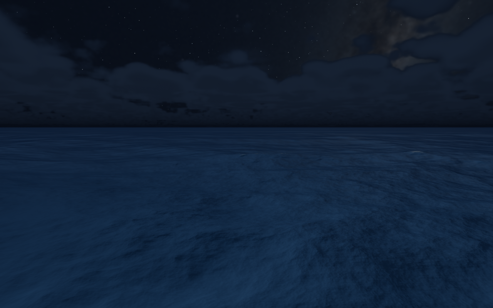
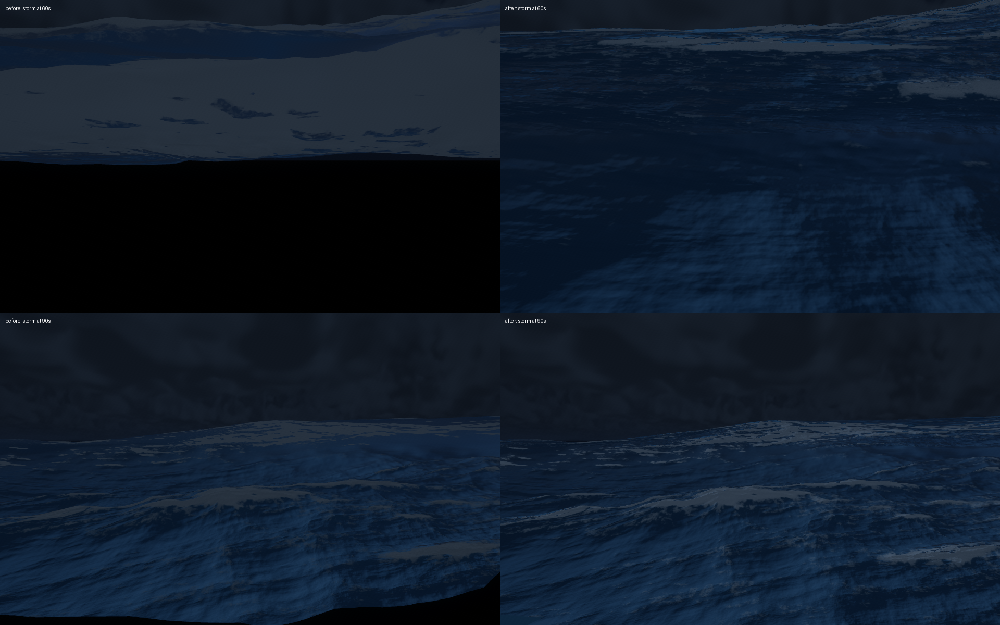

# Ocean

A cinematic ocean being developed into a live macOS wallpaper. The current app uses **Swift, AppKit, MetalKit and Metal**, with a fixed view across the water. Waves, volumetric clouds, rain, sunlight, moonlight and stars respond to time and weather.

**Start here:** [developer handoff](docs/handoff.md) · [architecture](docs/architecture.md) · [testing](docs/testing.md) · [next work](docs/engineering-roadmap.md).



## Current status

`main` is the current native Metal implementation. The root HTML/JavaScript renderer is retained as a browser reference. The separate historical `feature/native-macos-wallpaper` branch and its browser-host implementation predate the Metal rewrite.

| Capability | Status |
|---|---|
| Fixed ocean viewpoint, animated waves, foam and reflections | Implemented |
| Native Metal rendering, bounded resolution, 30 FPS default | Implemented |
| Volumetric clouds, scene-space rain, gradual storm transitions | Implemented |
| Local sunrise/sunset, independent Sun/Moon motion, remote starry sky | Implemented |
| Approximate IP location, cached weather and offline fallback | Implemented; no GPS permission prompt |
| Desktop windows behind icons, menu bar controls and shared HDR presentation across displays | Implemented on this branch; real display arrangements need manual verification |
| Adaptive frame rate and resolution for coverage, power and thermal state | Implemented with conservative visibility checks |
| Pause on occlusion, minimization, lock, screensaver, sleep and inactive session | Implemented |
| Storm waves passing the camera and night foam correction | Implemented and GPU-tested |
| Shared simulation/HDR across displays | Host implemented; physical multi-monitor verification remains open |
| Regional rendering demand | Planned; pure demand/layout contracts and a diagnostic exist |
| Open at Login | Registration control provided; installed/signed bundle behavior needs manual verification |

The objective is a lightweight, continuous wallpaper with real local daylight and weather, a fixed ocean composition, and cinematic nights without city light pollution. Inland weather drives an idealized sea state; it is not a marine swell forecast.

## Build and run

Use an Apple silicon Mac with macOS 13+ and Xcode Command Line Tools:

```sh
git clone https://github.com/GodlyDonuts/web-ocean.git
cd web-ocean
zsh macos/build.sh
open macos/build/Ocean.app
```

No npm packages, Python, Rust, development server or downloaded assets are required for the native build. Swift builds the app bundle; packaged Metal sources compile into retained pipeline states at startup. The included galaxy asset is ready to use. See its [credits and provenance](macos/Assets/Galaxy/CREDITS.md).

The app starts in desktop wallpaper mode with a wave icon in the menu bar. It offers pause, local daylight/weather, frame-rate and resolution budgets, display selection, and Open at Login. For the original resizable/full-screen development window, use:

```sh
macos/build/Ocean.app/Contents/MacOS/Ocean --preview
```

The camera remains fixed. Use weather controls for manual storm previews or automatic mode for local weather. Quit through the menu bar. See [the desktop host and verification limits](docs/wallpaper-host.md).

The preview caps its internal image at approximately 1,024,000 pixels, preserves aspect ratio and defaults to 30 FPS. The standard 1280×800 view uses 98,304 ocean triangles. Wave simulation updates six periodic 256×256 FFT bands; these are reusable wave tiles rather than a fully meshed world. Geometry is concentrated in the viewport with sparse displacement guards, including a near patch behind the camera that prevents holes during overtaking storm waves.

[Measured resource usage on an M1](docs/resource-usage-2026-11-06.md): roughly 5–6% of one CPU core, 97–121 MiB physical footprint and 8–11 ms mean GPU work per frame in offscreen 1280×800/30 FPS fixtures. Backing off covered-desktop polling reduced measured idle CPU from 0.36% to 0.12%, with zero submitted rendering frames. These measurements exclude WindowServer overhead and do not establish battery life.

## Check the current implementation

The native build has no test dependencies. Some GPU analysis scripts need Python with NumPy and Pillow:

```sh
python3 -m venv .venv
source .venv/bin/activate
python3 -m pip install -r requirements-dev.txt
zsh macos/test-current.sh
```

This maintained handoff gate builds the app, checks CPU contracts, and validates daylight, weather, night-water rendering, mesh coverage and the windowless lifecycle. It takes several minutes and writes disposable captures to ignored `macos/build/` directories. GPU fixtures use synthetic coordinates and do not perform IP lookup or write user astronomy caches. They create **zero application windows**.

For a quick CPU-only check, run `zsh macos/test-unit.sh`. For the broader development suite, run `zsh macos/test.sh`. [Testing instructions](docs/testing.md) distinguish maintained regressions, optional visual reviews, historical comparisons and performance measurements. CI builds native sources and runs CPU checks; hosted CI is not a substitute for real Mac GPU validation.

## Time, location and weather

The app looks up coarse location by public IP through `ipwho.is`, reuses it for astronomy and weather, and caches the result. Weather comes from Open-Meteo. Normal operation can therefore contact those services; neither is required for the deterministic GPU fixtures. No account or API key is required by the current implementation.

Solar timings and hourly celestial samples are cached daily; real UTC drives the sky independently of wave phase. The Moon has its own path and phase. Weather is cached for 15 minutes and transitions continuously; IP location is refreshed infrequently, with a 24-hour cache. Saved state lives under `~/Library/Application Support/OceanWallpaper/`. Offline operation retains available cached state. See [day/night details](docs/day-night-cycle.md) and [weather behavior](docs/dynamic-weather.md).

## Where to work

| Area | Source / guide |
|---|---|
| Window lifecycle and menus | `macos/main.swift` |
| Resource ownership and frame encoding | `macos/OceanRenderer.swift` |
| Wave simulation, surface, foam, rain and sky | `macos/Shaders/` and [architecture](docs/architecture.md) |
| Astronomy and IP location | `macos/CelestialCycle.swift`, `macos/ObserverLocationProvider.swift` |
| Weather state and providers | `macos/Weather.swift`, `macos/WeatherProvider.swift` |
| Animation timing | `macos/AnimationClock.swift` |
| Display demand contracts and diagnostic | `macos/SharedSurfaceDemand.swift`, `macos/Diagnostics/` |
| Tests and experiments | `macos/Tests/` and [testing guide](docs/testing.md) |
| Research and evidence | `research/`, `docs/` and [documentation index](docs/README.md) |
| Optional shader migration tools | `tools/`; these are not part of normal native builds |
| Retained browser reference | `index.html`, `js/`, `ocean.html`, `ocean.min.html` |

## Continue development

Read [the handoff](docs/handoff.md) before changing render architecture. The desktop host now shares one simulation/HDR frame and composites it to visible displays. The next milestone is to validate real multi-display, Space/full-screen and reveal behavior, then improve environment ownership and installed-app lifecycle. Preserve the current fixed view, no-prompt IP location, continuous transitions, bounded GPU work and windowless automated tests.

Current limitations include approximate lunar positioning, procedural resolved stars, approximate cloud multiple scattering, a height-field underwater treatment, and no shoreline or overturning breakers. Startup shader compilation and reduced internal resolution are deliberate tradeoffs. Performance reports in `docs/` identify their scenes and revisions; compare matched before/after runs rather than combining timings from different versions. The latest storm-water correction measured about 10.62 → 10.58 ms mean GPU time in a short M1 comparison; this is not a battery-life claim.



## Browser reference

Node.js and npm are optional for the retained browser version:

```sh
npm ci
npm start
```

Open the local URL printed by the server in a browser with WebGPU support. `npm run build` regenerates the standalone HTML artifacts. Browser controls and rendering behavior are historical reference material; the native app has no free camera. Do not run the shader-export tools over hand-edited Metal without reviewing the diff: native Metal is the active source of truth.

See [contribution guidance](CONTRIBUTING.md) for changes, bug reports and evidence expectations.

## Origins and license

The original WebGPU renderer was built with Claude Code (Opus 5.5). This project extends it into a native macOS ocean wallpaper. Code is MIT licensed; see [LICENSE](LICENSE). NASA/Gaia-derived imagery has separate [credits and usage guidance](macos/Assets/Galaxy/CREDITS.md). Imported research retains its original files and attribution under [research/](research/README.md).
