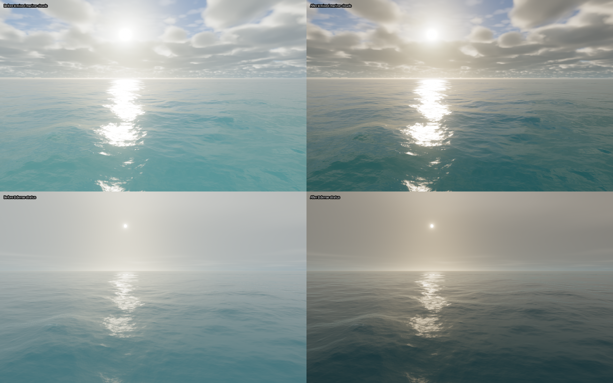

# Cinematic daylight

The daytime ocean could wash into one pale gray-blue range, even when sunrise, sunset and moonlight already looked good. This revision gives the higher-Sun scene deeper teal water, stronger separation between diffuse fill and directional highlights, and readable cloud undersides. It follows the real time/weather settings; it does not hold the wallpaper at sunset or replace overcast weather with a clear sky.



Left: before. Right: after. Top: the cached mixed marine-cloud conditions at a fixed morning time. Bottom: a dense stratus stress case. These are actual Metal readbacks at 960×600 with fixed wave time, location, lighting UTC and weather in each pair. They are controlled renders, not screenshots of the native wallpaper host or photographs. The reference supplied by the user informed tonal/color separation; its low Sun and broken clouds are a different weather/time condition.

The later [sea-state audit](sea-state.md) changes swell period and weather coupling. These captures precede that wave-geometry correction; the daytime lighting treatment remains in use.

## Rendering changes

- `OceanRenderer.swift` writes a daytime look weight into the existing reserved composite `q.w`. It is reset every frame and derived from `smoothstep(0.08,0.30,displayedSun.y) * (1-night)`. The reference/static-Sun path retains zero weight.
- `COMPOSITE.metal` gradually lowers daytime exposure to 65% of the previous setting, eases the fixed blue white balance from -0.19 toward -0.04, and adds 0.18 to the existing AgX look power plus 0.04 saturation at full weight. Both normal and mirror presentation paths use identical arithmetic. This reserves more tonal range for the sunlit reflection instead of lifting the whole frame together.
- `OCEAN.metal` attenuates excessive diffuse body fill toward RGB factors (0.25,0.42,0.50) at full weight. Fresnel reflection, the directional specular BRDF, the wave spectrum and camera remain intact. Daytime foam receives a restrained normal-dependent fill adjustment.
- `VOLUMETRIC_CLOUDS.metalinc` uses the height and density probes already available to reduce sheltered-base ambient fill and broad multiple-scattering fill. It removes an overwritten intermediate ambient calculation. The shared visible sky and environment cube therefore agree.

The weight fades to zero as the displayed Sun approaches the horizon and stays zero at night. Warm low-Sun light still comes from atmospheric scattering. Existing sunrise/sunset timing, artistic centered Sun/Moon arc, lunar phases, held-time controls and weather transitions remain in use.

No passes, texture lookups, cloud march/light-ray counts, scene textures, mesh density or uniform-buffer size were added. The appearance change adds a few scalar/vector operations to existing passes; this is not a claim of zero GPU cost or lower energy use.

## Validation and continuation

A short ABBA comparison at 1280×800 measured mean GPU command-buffer time of 7.46 ms before and 7.61 ms after, with unchanged Metal allocation (86,441,984 bytes). Each run discarded 60 warmup frames and measured 120 frames. This small sample measures the cost of this scene and does not establish whole-system power or temperature.

See [the dated report](cinematic-daylight-report-2026-11-07.json) for final checks, matched-image differences and the short interleaved GPU comparison. Raw readbacks, baseline/review app bundles and logs are local ignored artifacts under `macos/build/cinematic-day/`.

Diagnostic app copies must have unique bundle identifiers and no embedded `PlugIns` directory before execution. Otherwise macOS can register their copied wallpaper extensions and select a baseline build; the duplicates created during this review were unregistered and removed from the diagnostic bundles, and final installation was verified against the product executable path.

The cached-weather comparison used an isolated diagnostic renderer whose initial weather was read from Ocean's existing cache, while retaining the same production rendering code. The installed app's weather handling was not modified. Standard golden-hour, sunset, night and storm fixtures used the production app directly. Do not treat the diagnostic initialization as a new product feature or use changing live weather to compare two revisions.

For another appearance change, hold UTC, location, weather, wave time, dimensions and camera constant in both variants, inspect sky and water separately, and retain sunset/night checks. Useful maintained checks:

```sh
zsh macos/build.sh
python3 macos/Tests/verify_day_night.py
python3 macos/Tests/verify_cloud_variety.py
python3 macos/Tests/verify_night_water.py
python3 macos/Tests/verify_wallpaper_lifecycle.py
```

The wallpaper extension, screensaver and app package the same shaders. Relaunch the controller after rebuilding; its existing fingerprint verification refreshes the native wallpaper host. The prior drawable acquisition and lock/wake recovery fixes remain in place.
