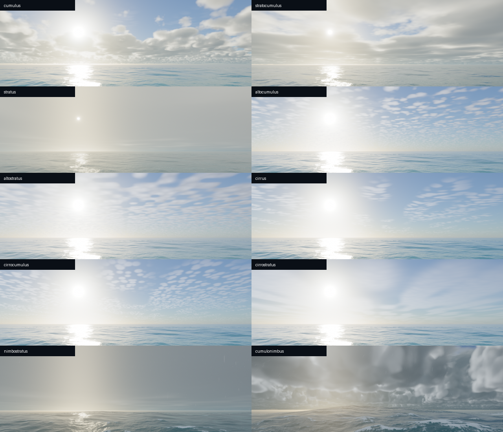

# Cloud families and weather mixtures

The sky now combines distinct low, middle and high forms instead of stretching one billowy layer for every condition. The ten families follow the broad appearance categories in the [WMO Cloud Atlas](https://cloudatlas.wmo.int/en/cloud-identification-guide.html); this is a cinematic renderer rather than a full atmospheric simulation.

| Family | Rendered appearance |
|---|---|
| Cumulus | Separate rounded low volumes with illuminated edges |
| Stratocumulus | Broad broken rolls and shallow connected banks |
| Stratus | Low, shallow continuous decks |
| Nimbostratus | Deeper rain-filled sheets, dark bases and rain curtains |
| Altocumulus | Smaller middle-level tufts and patches |
| Altostratus | Broad translucent middle-level sheets |
| Cirrus | Thin stretched high wisps |
| Cirrocumulus | Small high cellular patches |
| Cirrostratus | A diffuse high veil |
| Cumulonimbus | Deep rising banks, varied tower heights and broader upper lobes |



Sky crops from matched native captures; rain/storm examples also use their corresponding weather and sea states.

## Automatic behavior

`CloudMorphology` derives continuous weights from current cloud cover, precipitation, wind/severity and thunder. Fair weather mixes low puffs, middle patches and high wisps. Increasing coverage broadens low decks and higher sheets; steady rain favors layered rain clouds; strong convective conditions grow towers. Regional noise varies the low-layer blend within an air mass. Existing weather smoothing and the same noise seed preserve continuous transitions.

The weather feed does not identify cloud genera or supply a vertical moisture profile. Mixtures are artistic interpretations of the available conditions, rather than a forecast of the exact species above the user. Existing Weather presets exercise these mixtures; Daylight presets can hold sunset illumination while clouds and waves keep moving.

## Rendering and cost

Low clouds, rain decks and towers use the existing volume march with different depth, base, shape scales and height profiles. Middle layers at 3.8 km and high layers at 8.5 km use inexpensive distant-shell approximations. All reuse the original immutable 64³ noise texture. Middle patches use two samples instead of another volume march; high cells add one conditional sample.

The visible sky, reflection cube and direct-light visibility share these helpers. Dense rain decks fade residual direct transmission at the opacity cutoff so a hot disk cannot shine through an opaque rain sheet.

There are no additional textures, render passes, cache timers or volume marches. The existing march-step limit is unchanged. The existing frame buffer grows by 16 bytes. Resolution, cadence, sky/reflection cache sizes and wave quality stay unchanged. [Dated validation and resource measurements](cloud-variety-report-2026-11-07.json) record the final build; short GPU timings do not establish battery life.

One final sequential M1 comparison at 1280×800/30 FPS measured mean GPU time of **8.00 → 8.90 ms** in daylight, **8.83 → 8.89 ms** at night, and **11.80 → 11.90 ms** in a storm. These intentionally different cloud scenes and short runs do not isolate a precise cost from background variation. Metal allocation totals stayed at 76.44 MiB clear / 82.44 MiB storm. WindowServer and whole-system energy are excluded.

## Development checks

```sh
zsh macos/build.sh
zsh macos/test-unit.sh
python3 macos/Tests/verify_cloud_variety.py
python3 macos/Tests/verify_volumetric_clouds.py
python3 macos/Tests/verify_cloud_motion.py
```

The gallery captures ten forms plus automatic weather with Metal validation, checks finite HDR/shared sky/reflection/shadow output and requires distinct transmission masks for key pairs. Clock tests cover wind advection, evolution without wind, accelerated time and the wave-clock wrap. Clear-sky HDR/display must still match the no-cloud reference exactly. Numeric checks complement native visual review.

Developer query overrides: `cloudType=auto`, `cumulus`, `stratocumulus`, `stratus`, `nimbostratus`, `altocumulus`, `altostratus`, `cirrus`, `cirrocumulus`, `cirrostratus` or `cumulonimbus`. Overrides set representative cover/veil and morphology; add `storm=0.4` for a raining nimbostratus fixture or `storm=0.85` for an active convective storm. Normal launches use the automatic weather mixture.
