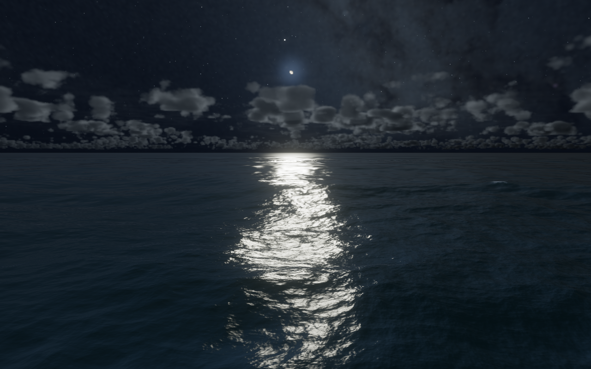

# Silver moonlight and deeper water

The November 2026 reference images call for dark open water, bright broken lunar reflections, cool cloud silhouettes and visible wave relief. The earlier lighting put too much diffuse blue across the entire sea, making troughs and crests look similar.



This is a deterministic native Metal capture with the real astronomical Moon for the fixture's time and heading. This lighting capture predates the later [visible nighttime Moon arc](wallpaper-moon.md). The live wallpaper retains local time, real Moon phase, fixed camera and weather. A bright lunar path appears when the Moon's direction and cloud transmission allow it; moonless nights remain darker. The camera does not chase the Moon.

## Rendering changes

- Reduced the broad blue sky floor and overhead fill. The water's existing directional reflection and Fresnel response now carry more of the scene's contrast.
- Increased the photographic lunar key from 0.12 to 0.35, still scaled by real phase, horizon visibility and the night factor. Its broken reflection comes from the existing simulated wave normals and slope distribution.
- Added a restrained local lunar aureole in the existing sky calculation. Cloud opacity occludes it; there is no separate glow layer.
- Reduced diffuse water scatter at night and shaped the remaining off-frame fill around wave normals. A nonlinear normal response separates lit faces from troughs without lifting display blacks.
- Reduced nighttime foam fill so crests belong to the darker water instead of looking like a gray coating. The existing underside-foam rejection and submerged-water treatment remain in place.

The dim off-frame fill is an artistic readability treatment, as in the previous implementation; it is not a physical starlight model. Daytime lighting, exposure, tone mapping, wave simulation, resolution budgets and cadence are unchanged. The change adds arithmetic inside existing passes, with no new textures, buffers, render passes or ray-march samples.

[Matched before/after comparison](silver-night-comparison.png) shows moonlit, moonless and storm scenes. Full six-scene review sheets and raw readbacks stay under ignored `macos/build/night-silver/`.

## Validation and reproduction

The saved baseline is revision `220707ef739adb0e22dd172e22b626ce080b61a9`. Build and save that app before changing the lighting:

```sh
zsh macos/build.sh
mkdir -p macos/build/night-silver
ditto macos/build/Ocean.app macos/build/night-silver/Before.app
python3 macos/Tests/verify_silver_night.py --before
# Apply the lighting revision and rebuild:
zsh macos/build.sh
python3 macos/Tests/verify_silver_night.py
```

The eight matched scenes cover a higher Moon, moonrise, lunar clouds, stars, a moonless night, a night storm, daylight and a daytime storm. Checks require finite nonnegative HDR, readable wave variation, stronger moonlit highlight contrast and **byte-identical daytime HDR/display output**. Display-luma statistics are image proxies, not physical photometry; native visual inspection remains necessary.

`verify_night_water.py` separately exercises raised storm faces, underside foam, rain, portrait views and actual camera submersion with Metal API/shader validation. The local daylight and celestial-motion checks verify the moving astronomical disks and offscreen lifecycle. These fixtures create no windows, perform no provider calls and write no user astronomy caches.

The [dated report](silver-night-report-2026-11-06.json) records image metrics, regression results and sequential unprofiled before/after measurements. Timings use 1280×800, 30 FPS, 240 frames and 60 excluded GPU warmup frames, in baseline/updated/updated/baseline order across the existing moonrise, moonless and storm benchmark fixtures. CPU uses Mach-timebase-corrected process sampling. Short runs on one M1 do not establish whole-system energy or battery life; WindowServer overhead is excluded.

On the local M1 (8 GiB, macOS 26.7), the mean of two runs per version was:

| Fixture | Baseline mean GPU (ms) | Updated mean GPU (ms) | Metal allocation (MiB), both versions |
|---|---:|---:|---:|
| Moonrise | 8.37 | 9.05 | 76.44 |
| Moonless | 8.25 | 8.62 | 76.44 |
| Night storm | 10.68 | 10.82 | 82.44 |

This is a measured rendering cost of about 0.1–0.7 ms/frame for the visual change, with run-to-run variation. It is not a speedup. Allocation totals are unchanged and overlap the process's unified-memory physical footprint.
